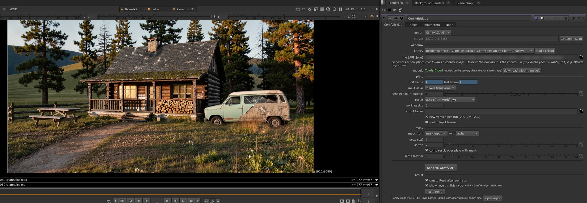

# ComfyBridge

**Run ComfyUI workflows on your plates from inside Nuke** and get the result back as EXR, with the colour pipeline handled.

*By David Borrull, VFX compositor. Repository: `nuke-comfy-pipe`.*



Send a plate → pick a workflow (depth, realism pass, your own…) → tweak its parameters in Nuke → the result comes out of the node. No exporting, no browser, no 8-bit PNGs in your comp.

> Status: **v0.8.3 — early, but working.** **Tested on Windows** (Nuke 17.1 Non-commercial, ComfyUI 0.38 portable, 8 GB GPU). **Linux not tested yet** (see [Linux](#linux)). The Comfy Cloud backend is new and has had little real-world use yet.

## Features

- **Bring your own workflow.** Any ComfyUI image workflow, with any model you have, runs from Nuke: export it as API JSON and drop it in the library folder. See [Your own workflows](#your-own-workflows).
- **LTX-2.5 video models on Comfy Cloud.** Alpha matte for the whole shot without a green screen (Alpha-Gen) and SDR → HDR that rebuilds clipped highlights as float values above 1. See [LTX-2.5 workflows](#ltx-25-workflows-comfy-cloud).
- **Image / video filter.** A *type* selector next to the library shows image workflows, video workflows or all; loading a workflow sets *mode* (frames / sequence) for you.
- **Workflow library with parameters.** Each workflow can carry a small metadata block; its parameters (denoise, prompt, seed, model…) show up as knobs in a *Parameters* tab.
- **Colour round-trip.** The plate is sent through the active Viewer transform (OCIO display/view, or Nuke's own LUTs) and colour results come back through the inverse, **scene-linear**, so they line up with the original (see [Colour](#colour-what-goes-out-and-what-comes-back) for the limits in the highlights). A round-trip test workflow is included in `examples/`.
- **Multi-input (3D → AI).** A workflow can ask for up to 3 extra images — depth, a second pass, AOVs — taken from a **layer of the plate** (multichannel EXR from Blender, Maya…), from the **aux input** or from the **mask input**. Data goes as float EXR and is normalised in ComfyUI (depth from Blender distance or Nuke 1/z → near = white for depth ControlNets); colour goes through the same viewer transform as the plate.
- **Model dropdowns.** Model / LoRA / ControlNet parameters list what your ComfyUI actually has (read from `/object_info`); a file in another subfolder is found automatically, and missing ones are reported on load.
- **Send exposure.** Brighten (or darken) what is sent, in stops — dark renders give the model nothing to work with. Colour results come back with the inverse, so the comp stays put.
- **Masked inpainting.** Connect a mask (or use the plate alpha); it is grown, softened and scaled to the plate, sent with it, and the result is comped back over the plate with a feathered mask — pixels outside the mask stay untouched.
- **Float EXR output.** A self-contained ComfyUI node (*Save EXR (ComfyBridge)*) writes float EXR with no extra dependencies. Data passes (depth) come back raw; images come back to linear.
- **Sequence mode.** Send the whole frame range as **one ComfyUI job** (a batch of images) instead of one job per frame: needed by temporal / video models (SeedVR2 flickers about 40 % less this way), and faster on Comfy Cloud (RTX upscale: ~65 s instead of ~150 s for 10 frames). Batch workflows can be split in chunks; results keep the original frame numbers. See [Sequence mode](#sequence-mode).
- **Versioned outputs.** Every run goes to a new `v001`, `v002`… folder — nothing is overwritten, so you can compare settings.
- **Working size.** Optionally downscale before sending (multiples of 32) and scale back on return. Handy with limited VRAM.
- **Clean node graph.** After each run a standalone Read (labelled with its version, plus inverse colour transform and Reformat if needed) is placed next to the node. Or turn that off and the result comes out of the ComfyBridge node itself.
- **Local ComfyUI or Comfy Cloud.** A *run on* switch sends the work to your own ComfyUI (or one on your network) or to Comfy Cloud, for models that don't fit your GPU. See [Comfy Cloud](#comfy-cloud).
- **Works within Nuke Non-commercial's Python limit** (10 Node objects per session): the node is pasted from a template and its internals are driven by expressions, so a run touches one node.

## Colour: what goes out and what comes back

Diffusion models are trained on display-referred 8-bit images (sRGB-like), not on scene-linear EXRs. ComfyBridge does the conversion both ways so you can stay in your linear comp:

1. **Out:** the plate goes through the **active Viewer transform** (your OCIO display/view, or Nuke's own LUT) and is sent as an 8-bit PNG — the model sees what you see in the Viewer. With *input color* = *sRGB* it is sent as plain sRGB instead.
2. **In ComfyUI:** the model works on that display image.
3. **Back:** colour results are saved as EXR and run through the **inverse** of the same transform in Nuke, so they come back **scene-linear** in your working space and line up with the plate. Data results (depth, mattes, normals) come back raw, untouched.

**Limits — mostly in the highlights:**

- Anything the Viewer transform pushes above display white is **clipped** before the model sees it. The inverse cannot rebuild what was clipped: bright windows, lamps, the sun or specular hits come back flat. With filmic / ACES views the inverse also expands the top of the range a lot, so the brightest returned values can be far from the original.
- **8 bits out** means some banding in smooth gradients after the inverse, most visible in skies and shadows.
- **What helps:** lower *send exposure* (negative stops) to fit the highlights into the display range — it is undone on return. Comp the AI result only where you need it (mask, keymix) and keep the original plate's highlights. Treat the result as a layer to integrate, not as a replacement plate.
- Check it on your own pipeline with *Test – colour round-trip* (in `examples/`).

## Models

You don't need to hunt for model files. When you load a workflow, the node shows which models it needs and whether your ComfyUI has them. Press **download missing models** and they go straight into your ComfyUI models folder (you're asked for that folder once). Downloads can be cancelled and resume where they stopped. A few models have no direct link (e.g. Civitai checkpoints): the node tells you where to get them.

The list of known models lives in `nuke/comfybridge/models_catalog.json`; add your own entries there or in a workflow's metadata (`"models": [{"file": ..., "folder": ..., "url": ...}]`).

## Install

**ComfyUI** (local only — not needed if you only use Comfy Cloud)
1. Copy `comfyui/ComfyUI-ComfyBridge` to `ComfyUI/custom_nodes/`.
2. Restart ComfyUI.

**Nuke**
1. Copy `nuke/comfy_bridge.py`, the icons `nuke/comfybridge.png` and `nuke/comfybridge@2x.png`, the `nuke/comfybridge` folder and the `nuke/comfy_bridge_workflows` folder to your `~/.nuke`.
2. Add to `~/.nuke/menu.py`:
   ```python
   import comfy_bridge
   comfy_bridge.install_menu()
   ```
3. Restart Nuke → **Nodes › ComfyUI › ComfyBridge**.

Set `COMFY_BRIDGE_URL` to point at a ComfyUI on another machine, and `COMFY_BRIDGE_WORKFLOWS` to use a shared workflow folder.

## Usage

1. Select your plate and create a **ComfyBridge**.
2. **test connection**.
3. Pick a **type** (*image*, *video* or *all*), then a workflow in **library** → **load / reload**. Adjust it in the **Parameters** tab.
4. Set the frame range → **Send to ComfyUI**. *mode* (frames / sequence) is set by the workflow when you load it; you can change it.
5. A Read with the result (labelled v001, v002…) appears next to the node. With *create Read after each run* off, the node outputs the result itself (*show result in this node*).

Hover any knob for its help, or press **help** next to *test connection* for a quick guide.

| Knob | What it does |
|---|---|
| run on | *local ComfyUI* (the *server* address) or *Comfy Cloud*. |
| type | Filter the library: *image* (one image at a time), *video* (the whole shot) or *all*. Depth and upscale workflows show in both. |
| mode | *frames*: one job per frame (any workflow). *sequence*: the whole range in one job. See [Sequence mode](#sequence-mode). |
| chunk size | Sequence mode, batch workflows: frames per job (0 = whole range). |
| send exposure (stops) | Exposure applied before sending (plate and inputs marked `match_exposure`); undone on colour results. |
| input color | *viewer transform*: send what you see in the Viewer, undo it on return. *sRGB*: always sRGB. |
| result | *auto* uses the workflow's metadata; force *data* (raw) or *color* (back to linear). |
| working size | Long edge in px (0 = original). |
| new version per run | Write each run to a new `vNNN` folder. |
| match input format | Scale the result back to the plate's format. |
| mask from | *mask input (alpha)* or *plate alpha*. Only used by workflows that take a mask. |
| grow / soften | Expand and soften the mask sent to ComfyUI (gives the model room to blend). |
| comp result over plate with mask | Output = result keymixed over the plate. Turn off to see the raw result. |
| comp feather | Feather of the comp mask. |
| mask send | *alpha*, or *rgba (as is)* for colour-coded masks (e.g. red = regenerate, green = take another pass). |

### Inputs tab

When a workflow needs extra images, they show up here. For each one:

| Knob | What it does |
|---|---|
| from | *plate*, *aux input* or *mask input* — the stream to take it from. |
| layer | Which layer of that stream (`rgba`, `depth`, `P`, your custom passes…). Bring a pass into the plate with a Copy/ShuffleCopy, or plug it into **aux**. |
| send | *color (like plate)* or *data (raw)*. Inputs that the workflow reads with **Load EXR (ComfyBridge)** always go as raw float EXR. |

Every extra input is resized to the plate (or the working size).

**First thing to try:** *Test – colour round-trip* (in [`examples/`](examples/README.md)). `Merge (difference)` the result against the original and gain up: it should be ~black (8-bit quantisation and highlights beyond the display range aside).

## Included workflows

| Workflow | Output | Needs | Comfy Cloud |
|---|---|---|---|
| Depth – Depth Anything V2 | float EXR, raw | [ComfyUI-DepthAnythingV2](https://github.com/kijai/ComfyUI-DepthAnythingV2) (downloads its model) | yes |
| Depth – Depth Anything 3 | float EXR, raw | ComfyUI core nodes (no custom node). Models in `models/geometry_estimation` (mono large, base, small) | yes (tested) |
| Depth – MoGe 2 (depth / normals) | float EXR, raw | ComfyUI core nodes. `moge_2_vitl_normal_fp16` in `models/geometry_estimation`. Best single-frame geometry; depth 0–1 near = white, or normals | yes (tested) |
| Render to photo – Qwen-Image 2512 + depth image (PNG) | half EXR, linear | Qwen-Image 2512 (fp8), Qwen 2.5 VL text encoder, Qwen-Image VAE, Qwen-Image 2512 Fun ControlNet. Depth as a grey image in **aux** (near = white, e.g. from Depth Anything or a normalised Blender Z) | yes |
| Render to photo – Z-Image Turbo + ControlNet Union | half EXR, linear | Z-Image Turbo, Qwen3 4B text encoder, Flux VAE (`ae`), Z-Image-Turbo-Fun-Controlnet-Union (model_patches). Control image in **aux** (grey depth near = white, pose, lines) or canny of the plate. Fast (8 steps) | yes (tested) |
| Relight – Qwen Image Edit 2509 | half EXR, linear | Qwen-Image-Edit 2509 (fp8), Qwen 2.5 VL text encoder, Qwen-Image VAE, Lightning 4-step LoRA, Relight LoRA. Describe the new light | yes (tested) |
| Edit – FLUX 3 Image Klein (distilled) | half EXR, linear | FLUX 3 Image Klein int8, Qwen3-VL 4B text encoder, FLUX.2 VAE. Write the edit as `In <ref_image_0>, ...`. Check the FLUX 3 licence | yes (tested) |
| Edit – Qwen Image Edit 2511 (plate + reference) | half EXR, linear | Qwen-Image-Edit 2511 (fp8mixed), Qwen 2.5 VL text encoder, Qwen-Image VAE, 2511 Lightning LoRA. Reference (material, object, style) in **aux** | yes (tested) |
| Inpaint – Qwen-Image InstantX (mask) | half EXR, comped over plate | Qwen-Image (fp8), Qwen 2.5 VL text encoder, Qwen-Image VAE, Qwen-Image Lightning 4-step LoRA, InstantX Inpainting ControlNet | yes (tested) |
| Outpaint – Flux.1 Fill | half EXR, **bigger than the plate** | FLUX.1 Fill dev, clip_l, t5xxl, Flux VAE (`ae`). Non-commercial licence | yes (tested) |
| Upscale – SeedVR2 3B Int8 | half EXR, **bigger than the plate** (x2 default) | SeedVR2 3B int8 + SeedVR2 VAE (ComfyUI native nodes). Colour correction *lab* keeps the plate grade. Use **sequence** mode on shots: less flicker | yes (tested) |
| Upscale – RTX Video Super Resolution | half EXR, **bigger than the plate** (x2 default) | NVIDIA RTX nodes (`comfyui_nvidia_rtx_nodes`). Fast x1–x4 upscale, or denoise / deblur at the same size. Check the NVIDIA Video Effects SDK licence | **Cloud only** (tested) |
| Matte – LTX-2.5 Alpha-Gen | float EXR, raw (matte as grey RGB) | LTX-2.5 22B distilled + Alpha-Gen IC-LoRA 0.9 (Lightricks), Gemma 4 12B encoder. Video: sequence mode | **Cloud only** (tested) |
| HDR – LTX-2.5 SDR to HDR | half EXR, **scene-linear, values above 1** | LTX-2.5 22B distilled + SDR-to-HDR IC-LoRA (Lightricks), float32 VAE. Video: sequence mode | **Cloud only** (tested) |

Every workflow in the library runs on Comfy Cloud (RTX Video Super Resolution and the LTX-2.5 ones only there). Tools (colour round-trip test, extra-input test) and alternative or experimental workflows (SDXL inpaint and realism, Qwen-Image-Edit 2509 with SAM3 mask, Qwen Image 2.1 edit, Render to photo from a float EXR depth (local, Load EXR) and its FAST variant, edges, style reference, mix passes) are in [`examples/`](examples/README.md).

## Sequence mode

Set **mode** to *sequence* and the frame range goes to ComfyUI as **one job**: the frames are rendered from Nuke as usual (Reformat, Grade, viewer transform, send exposure… all respected), uploaded once, and the workflow's `LoadImage` is replaced by one `LoadImage` per frame joined with **Batch Images** (ComfyUI core nodes only, so it works on Comfy Cloud too; groups of 50). The mask, if any, is batched the same way; the aux input is not (it is sent once). The results come back with the **original frame numbers**.

Each workflow says how it can run (`"sequence"` in its metadata; shown under the frame range):

| Kind | Workflows | Sequence mode |
|---|---|---|
| batch | Depth Anything V2 / 3, MoGe 2, RTX Video Super Resolution | One job, or split with **chunk size** (e.g. to keep Cloud jobs small). Same result as frames mode, faster on Cloud. |
| temporal | SeedVR2, LTX-2.5 Alpha-Gen, LTX-2.5 SDR → HDR | The whole range in one job (chunk size is off). The model looks across frames: less flicker. |
| no | Edit, Inpaint, Relight, Render to photo, Outpaint | Blocked with a message: these work on one image at a time. Use *frames*. |

All chunks are queued at once; if one fails, ComfyBridge asks to retry just that chunk. Tested: identical PNGs give the same result in both modes (Depth Anything V2: max difference 4e-5).

## LTX-2.5 workflows (Comfy Cloud)

LTX-2.5 (Lightricks, 22B) is a video model; its IC-LoRAs turn it into tools that work on a whole shot. They are too big for most local GPUs, so they run on Comfy Cloud, in **sequence** mode (set when you load them). ComfyBridge pads the range to the frame count they need (8n+1, the last frame repeated) and the image to multiples of 32 px, and removes the padding when the result comes back.

- **Matte – LTX-2.5 Alpha-Gen.** Alpha of the main subject for the whole shot, without a green screen (hair included). Prompt usually empty. The matte comes back as grey RGB (data): shuffle it into alpha. It picks the obvious subject; you cannot choose which one.
- **HDR – LTX-2.5 SDR to HDR.** Rebuilds the highlights of an SDR plate: a clipped sun comes back with values of 15–20. Send the plate as you see it (viewer transform or sRGB); the result comes back **scene-linear Rec.709** (the Read is tagged linear and the viewer transform is not undone). Mid-tones come back about half a stop brighter than the plate: match them with a Grade if needed. Lightricks' fixed scene embeddings are not on Comfy Cloud, so an empty prompt replaces them.

Tested from Nuke on Comfy Cloud: 10–20 frames at 960×540 take 35–60 s. The LTX-2.5 weights are under the LTX community licence (see [Model licences](#model-licences--read-before-commercial-work)).

## Comfy Cloud

For models that don't fit your GPU, set **run on** to *Comfy Cloud*. You need a paid Comfy Cloud plan and an API key (platform.comfy.org → API Keys).

- Save the key, on one line, in `Documents/ComfyBridge/comfy_cloud_api_key.txt`, or set the `COMFY_API_KEY` environment variable. It is never written to the Nuke script.
- **test connection** checks the key and shows the account.
- On Cloud, *Save EXR (ComfyBridge)* is replaced on the fly by ComfyUI's own *Save Image (Advanced)* in EXR, so results still come back as float EXR. The other ComfyBridge nodes (Load EXR, Crop To Mask / Stitch) are not on Cloud: those workflows are flagged *not for Cloud* when loaded.
- Model lists in *Parameters* come from Cloud. If a workflow names a model Cloud doesn't have, pick another one from the list.
- Cancelling also removes the frames still queued on Cloud, so they are not charged.

## From 3D: render → photo

1. Render from Blender (or any DCC) the beauty and a depth pass. Make the depth a grey image in Nuke: **near = white, far / sky = black, 0–1** (Grade or Expression on the Z pass, or run **Depth – MoGe 2** or **Depth – Depth Anything 3** on the render).
2. Plug the render into the main input and the grey depth into **aux**.
3. Load **Render to photo – Qwen-Image 2512 + depth image (PNG)** (or **Z-Image Turbo + ControlNet Union**, faster). The Inputs tab shows the depth coming from the aux input.
4. *denoise* ~0.6 keeps the look of your render; ~0.9 reinvents the textures while the depth keeps the geometry.

With a local ComfyUI and the ComfyBridge nodes installed, `examples/` has a version that reads the raw Z pass as float EXR (more depth precision, no 8-bit steps) and a FAST one; the **Mix passes + inpaint** example combines two results with a colour mask (GREEN takes the aux pass, RED is regenerated).

> Qwen-Image 2512 is a 20B model. On 8 GB of VRAM the fp8 file runs with offloading (slow); for production point *server* to a bigger GPU on your network, or run it on Comfy Cloud. The model file names are parameters, so a GGUF or another quantisation is a knob change (with the matching loader).

## Masks

Masked workflows declare `"mask_node"` in their metadata. ComfyBridge renders the mask (from the mask input or the plate alpha, grown and softened, scaled to the plate format) as a second image. **Inpaint – Qwen-Image InstantX** works on the whole frame at its *work size*; back in Nuke the result is keymixed over the plate with the feathered mask.

With a local ComfyUI, the ComfyBridge nodes **Crop To Mask** → model → **Stitch** process only the masked region plus some context at the model's resolution (used by the SDXL inpaint and Qwen-Image-Edit 2509 examples). They are not on Comfy Cloud.

Prompting tips: for **inpaint** describe what *should* be there ("old brick wall"), not what to remove. For the **Edit** workflows (Qwen-Image-Edit, FLUX 3 Klein) write an instruction ("remove the cable and continue the wall").

## Your own workflows

**Bring your own workflow and your own models.** Any image workflow you build in ComfyUI, with any model you have installed, can run from Nuke:

1. Build it in ComfyUI with a `LoadImage` (the plate goes there) and a `Save EXR (ComfyBridge)` or core `Save Image (Advanced)` in EXR (float EXR back), or `SaveImage` (8-bit PNG back).
2. Export it with **Workflow › Export (API)** (the normal UI JSON won't load).
3. Drop it in `comfy_bridge_workflows` and press **load / reload**.

Without metadata it already works: the plate goes to the first `LoadImage`, the result comes from the first save node, and KSampler settings (seed, steps, cfg, sampler, scheduler, denoise) show up in *Parameters*. **One catch:** with no metadata the result is treated as *data* (like depth). For an image, set *result* to **color (image)** on the node, or add `"output": "color"` to the metadata.

Add a `_comfy_bridge` block to name it, expose more knobs (prompt, model dropdowns from your ComfyUI…), and use masks or extra inputs:

```json
"_comfy_bridge": {
  "name": "My workflow",
  "description": "What it does",
  "output": "data | color",
  "params": [
    {"label": "denoise", "node": "8", "input": "denoise", "type": "float", "min": 0, "max": 1},
    {"label": "prompt +", "node": "3", "input": "text", "type": "text"},
    {"label": "model", "node": "2", "input": "ckpt_name", "options": ["a.safetensors", "b.safetensors"]}
  ]
}
```

Optional keys:

| Key | Meaning |
|---|---|
| `"mask_node": "11"` | LoadImage that receives the mask. |
| `"mask_channels": "rgba"` | Send the mask as RGBA (default: alpha in all channels). |
| `"plate_node": "1"` | LoadImage that receives the plate (default: the first LoadImage that is not the mask or an extra input). |
| `"matte": true` | The result's alpha is a matte: output it as alpha. |
| `"match_format": false` | Keep the result's own size (upscalers, outpaint). Default: scaled back to the plate format. |
| `"send_exposure": false` | Generative workflow that does not keep the exposure it receives (relight, repaint): send exposure is reset to 0. |
| `"sequence": "batch"` | Sequence mode: `batch` (frames are independent, can be chunked), `temporal` (whole range in one job), `no` (default: single image only). |
| `"media": "both"` | Library type: `image`, `video` or `both`. Default from `sequence` (temporal → video, batch → both, no → image). |
| `"out_colorspace": "linear_rec709"` | The result is already scene-linear in that space (`linear_rec709`, `acescg`): the Read is tagged with it and the viewer transform is not undone. |
| `"work_size": 960` | Working size set when the workflow is loaded (heavy video models). |
| `"frame_ratio": 2` | Output frames per input frame (frame generation: N frames → 2N-1). The Read is retimed; a message says so. |
| `"constraints": {...}` | For video models: `"frames_rule": "8n+1"` (the last frame is repeated to fit, extra frames dropped on return), `"size_multiple": 32` (padded and cropped back), `"max_frames": 121`. With `size_multiple`, `"output_scale"` tells the crop the result's scale. |
| `"match_exposure": true` (in an input) | That input gets the same send exposure as the plate. |
| `"inputs": [...]` | Extra images, up to 3: `{"node": "2", "label": "depth", "from": "plate", "layer": "depth", "mono": true, "send": "data"}`. `from`: `plate` / `aux` / `mask`. A `LoadImage` receives an 8-bit PNG; a **Load EXR (ComfyBridge)** receives a float EXR. |

Workflows that process the whole shot at once run in [sequence mode](#sequence-mode). More workflows (tools and experiments) are in [`examples/`](examples/README.md).

## ComfyUI nodes

| Node | What it does |
|---|---|
| Save EXR (ComfyBridge) | Float/half EXR output, no dependencies. |
| Load EXR (ComfyBridge) | Reads scanline EXR (none / ZIP compression — Nuke's defaults). Modes: *color (linear → sRGB)*, *data*, *depth: distance → 1/z*, *depth: distance normalize + invert*, *depth: Nuke 1/z*. |
| Crop To Mask / Stitch (ComfyBridge) | Process only the masked region at the model's resolution and paste it back, optional colour match and matte. |
| Mark Mask (ComfyBridge) | Tints the masked area for instruction-edit models. |

## Model licences — read before commercial work

The code is MIT. **The models are not covered by it.** Some common ones are non-commercial:

- Depth Anything V2 **Large** — CC-BY-NC-4.0 (non-commercial). **Small** — Apache 2.0.
- Depth Anything 3 **Small, Base, Mono Large, Metric Large** — Apache 2.0. **Large, Giant, Nested** — CC BY-NC (non-commercial).
- MoGe 2 — MIT.
- Qwen-Image / Qwen-Image 2512 / Qwen-Image-Edit and the Lightning LoRAs — Apache 2.0. Check each ControlNet's and LoRA's own licence (InstantX Inpainting, Relight LoRA).
- SeedVR2 (ByteDance) — Apache 2.0.
- NVIDIA RTX Video Super Resolution — NVIDIA Video Effects SDK licence (check it before paid work).
- LTX-2.5 and its IC-LoRAs (Lightricks) — LTX community licence: commercial use free for companies under $10M annual revenue; above that a commercial licence from Lightricks is needed. Read the full terms on the model pages.
- Z-Image Turbo and its Fun ControlNet Union — Apache 2.0.
- FLUX.1 dev / Fill dev / Kontext dev and FLUX.2 [klein] 9B — non-commercial. FLUX 3 Image Klein — check its licence on Hugging Face before commercial use. FLUX.2 [klein] 4B — Apache 2.0.
- SDXL-based checkpoints — check each checkpoint's own licence.

Check every model's licence before using results on paid work.

## Known issues / notes

- **Troubleshooting from real use:** a broken `xformers` install can make Depth Anything output smooth blobs (uninstall it); some versions of the DepthAnythingV2 node fail with *"more than one element of the written-to tensor refers to a single memory location"* on sizes that are exact multiples of 14 (replace `.expand(-1, -1, -1, 3)` with `.repeat(1, 1, 1, 3)` in its `nodes.py`).
- In *frames* mode each frame is a separate job. Image models (SDXL, Qwen, Flux) are not temporally stable: expect flicker on sequences. Temporal models (SeedVR2) flicker less in *sequence* mode.
- Nuke dithers when it writes the 8-bit PNGs that are sent, so two runs of the same plate are not bit-identical (±1/255 in, small differences out).
- Nuke blocks while ComfyUI works (the progress bar can cancel).
- Nuke Non-commercial caps output at HD and saves `.nknc` scripts.

### Linux

Not tested yet. The code avoids Windows-only paths and calls, and prepares a few things for it:

- Model file names in workflows saved on Windows (`Qwen\model.safetensors`) are matched by file name to what your ComfyUI lists (`Qwen/model.safetensors`), so the same workflow works on both.
- Settings are saved next to the install, or in `~/.nuke` if that folder is read-only (shared studio installs).
- The Comfy Cloud key file is looked for in `~/Documents/ComfyBridge/` (or use `COMFY_API_KEY`).

If you try it on Linux, an issue with what worked and what didn't is very welcome.

## Roadmap

- OCIO input transform per input (colourspace, display/view, look, CDL/LUT file) and an ACEScct option.
- More LTX-2.5 IC-LoRAs: Layout to Render (clay / blockout + look still → photoreal shot), refine / restore, and Tiled Fusion for HD and long shots.
- Object removal in video with a mask: Wan VACE and LTX clean-plate / HDR inpainting.
- Matte by text: SAM 3 + ViTMatte.
- Matte refinement (SDMatte / BiRefNet).
- Video depth with temporal consistency (DepthCrafter), batches with overlap.
- Depth Anything 3 multi-view (stable depth + camera).
- A mode without plate (text to image), e.g. 360° panoramas to light CG.
- Background execution.

## Credits

Full notices, including adapted ComfyUI templates: [THIRD_PARTY_NOTICES.md](THIRD_PARTY_NOTICES.md).

- Display/view colour round-trip and workflow metadata ideas: [nuke-comfyui-bridge](https://github.com/Mariolepipe/nuke-comfyui-bridge) by Mario Falco (MIT).
- Round-trip test and auto-versioning ideas: [comfyui-exr-plate](https://github.com/Samuelsujan/comfyui-exr-plate) (MIT).

## How it was made

Designed and tested in production by David Borrull, a VFX compositor. The code was written with Claude (Anthropic), directed and tested shot by shot in Nuke 17 and ComfyUI. Version history: [CHANGELOG.md](CHANGELOG.md).

## Licence

MIT © 2026 David Borrull
